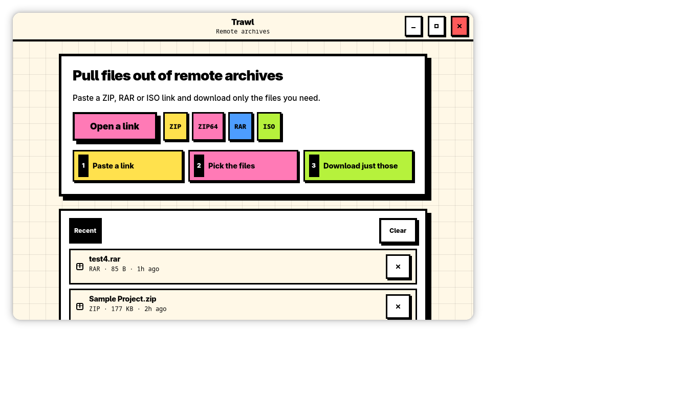
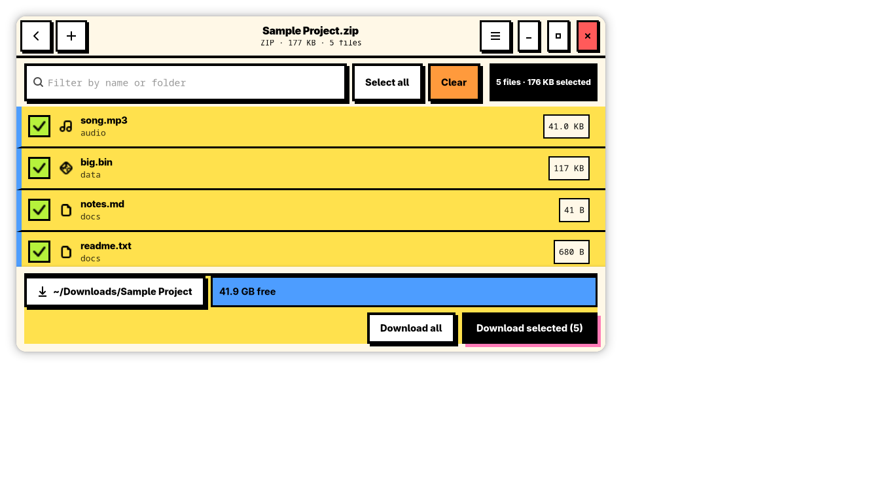

# Trawl

Browse remote ZIP, RAR and ISO archives and download only the files you need.





## What it does

- Reads the archive index over HTTP byte ranges — no full archive download first.
- Lets you pick individual files or download everything at once.
- Handles parallel downloads, resume, checksum verification and a finished notification.

## Install

```sh
git clone https://github.com/Swaggyxren/trawl && cd trawl && ./install.sh
```

The script asks before installing anything, checks version minimums, installs with pipx using system PyGObject, and adds a desktop entry and icons under `~/.local/share/`. It refuses to run as root. No AppImage or Flatpak.

Manual route:

```sh
pipx install --system-site-packages git+https://github.com/Swaggyxren/trawl
```

Minimums: **Python 3.10+**, **libadwaita 1.5+**. That means Ubuntu 24.04+, Debian trixie+, Fedora and Arch. Debian bookworm is too old. openSUSE is supported by the script but untested.

| Distro | System packages |
|---|---|
| Arch / CachyOS / Manjaro | `python python-gobject gtk4 libadwaita python-pipx desktop-file-utils` |
| Debian / Ubuntu / Mint | `python3 python3-venv python3-pip python3-gi gir1.2-gtk-4.0 gir1.2-adw-1 pipx desktop-file-utils` |
| Fedora / RHEL | `python3 python3-pip python3-gobject gtk4 libadwaita pipx desktop-file-utils` |
| openSUSE | `python3 python3-pip python3-gobject gtk4 libadwaita pipx desktop-file-utils` |
| Optional sound | `libcanberra` + `gsound` (Arch/Fedora/SUSE), `libcanberra-gtk3-module` + `gsound-tools` (Debian/Ubuntu) |

Upgrading from a pre-public build: settings and logs stay in `~/.config/trawl` and `~/.local/share/trawl`. The old desktop entry and icons named `io.github.ydnar.Trawl` can be removed manually.

## Usage

Press **+** or `Ctrl+L` to paste a link. After the index loads, choose **Download all** (confirm the destination, then download everything) or **Select files** (browse, filter and tick entries). The file list has **Download selected (N)** and a secondary **Download all**. On the choice screen the header shows a **Back to home** button; `Esc` also goes back. Downloads go to `~/Downloads/<archive name>` by default.

## Settings

`Ctrl+,` opens settings. Relevant options: **Verify checksums**, **Notify when a download finishes**, **Play a sound**, parallel connections, resume, overwrite/skip behaviour, custom headers and the choice-screen preference.

## Diagnostics log

Every launch writes JSON Lines to `~/.local/share/trawl/launches.jsonl`. It records timings, redacted URL hosts/paths, archive formats, download results and short error codes. Credentials, query strings, custom headers and free text are never written. The log never leaves your machine.

## Development

```sh
python3 -m py_compile $(find src -name '*.py')
PYTHONPATH=src python3 -m unittest discover -s tests -v
```

Tests generate their own ZIP/RAR/ISO fixtures and serve them from a local loopback HTTP server; they need no external network and no personal files.

## Known limits

- Supported formats: ZIP, ZIP64, stored RAR 4/5 and ISO 9660 only.
- Compressed RAR entries, encrypted archives, 7z, UDF-only ISOs and split archives are not supported.
- Servers must allow HTTP byte-range requests.
- The GUI was only tested on the author's own desktop, not in CI.
